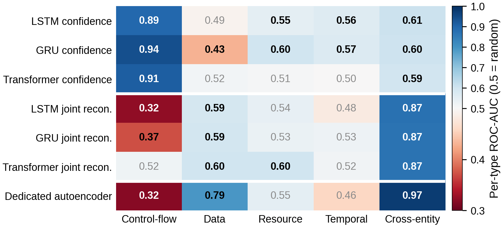

# Real-Time Anomaly Detection for ERP Process Flows

[](https://www.python.org/)
[](https://pytorch.org/)
[](LICENSE)

Deep sequential models that follow an ERP process event by event and flag anomalies while the case is still running. Three next-activity predictors (LSTM, GRU and Transformer) and a GRU sequence autoencoder score every new event. Each single model needs less than 6 ms per event on average on a laptop CPU, even for the longest prefix.

The models are trained and tested on the public BPI Challenge 2020 travel expense log. Five types of anomalies are injected into held-out cases: control-flow, data, resource, temporal and cross-entity. Trained weights, raw scores and all result files are included, so every number in this README can be checked without retraining.

- [Status](#status)
- [What changed in v2.0](#what-changed-in-v20)
- [Installation](#installation)
- [Data](#data)
- [Quick start](#quick-start)
- [How it works](#how-it-works)
- [Results](#results)
- [Repository layout](#repository-layout)
- [Where the numbers come from](#where-the-numbers-come-from)
- [Reproducibility](#reproducibility)
- [Known limitations](#known-limitations)
- [License and credits](#license-and-credits)

## Status

| | |
|---|---|
| Python | 3.10 or newer |
| Main libraries | PyTorch 2.2.2, scikit-learn 1.4.2, pm4py 2.7.11.4, pandas 2.2.2 |
| Hardware used | AMD Ryzen 5 PRO 7530U (6 cores), 16 GB RAM |
| GPU | not needed, everything runs on CPU |
| Final version | release `v2.0-submission` (the version described in the thesis) |
| Earlier version | release `v1.0-submission` (first configuration, see below) |

## What changed in v2.0

- **Read-out at the last real event.** Prefixes are padded to 26 positions. In v1.0 all three classifiers took their prediction from position 26, after the padding, and the Transformer used no padding mask. In v2.0 the LSTM and the GRU receive packed sequences and stop at the last real event, and the Transformer masks the padded positions and reads at the last real event. Data, seeds, hyperparameters and training protocol are unchanged. The new weights are in `results/models_last_real/` and their results in `results/last_real/`. The v1.0 weights and results stay in `results/models/` and `results/metrics/` for comparison.
- **The ranking of the architectures changed.** With the corrected read-out the three classifiers are within half a percentage point of one another, and the Transformer is ahead in every run. The lead of the GRU in v1.0 came from the read-out position.
- **Simple amount rules.** Two rules on the amount fields, without any learning, find the injected financial anomalies better than the autoencoder (`15_baselines_and_checks.py`).
- **Latency of model combinations.** The reported detection scores average three training runs. This costs three forward passes, which can exceed 10 ms (`16_ensemble_latency.py`, `18_last_real_evaluation.py`).

## Installation

```bash
git clone https://github.com/Wasif-Allvi/real-time-erp-anomaly-detection-thesis.git
cd real-time-erp-anomaly-detection-thesis
python -m venv .venv
source .venv/bin/activate          # Windows: .venv\Scripts\activate
pip install -r requirements.txt
```

## Data

The project uses the public [BPI Challenge 2020](https://doi.org/10.4121/uuid:52fb97d4-4588-43c9-9d04-3604d4613b51) event log by Boudewijn van Dongen, published on 4TU.ResearchData. Two of its sub-logs are needed: *Domestic Declarations* and *International Declarations* (16,949 cases and 128,588 events together).

The log is not part of this repository. Download both sub-logs and unpack them into a `dataset/` folder next to the repository folder:

```
dataset/
├── BPI Challenge 2020_ Domestic Declarations_1_all/DomesticDeclarations.xes/DomesticDeclarations.xes
└── BPI Challenge 2020_ International Declarations_1_all/InternationalDeclarations.xes/InternationalDeclarations.xes
real-time-erp-anomaly-detection-thesis/
```

The paths are set in `config.py` if you want to change them.

## Quick start

The trained weights and the per-run anomaly scores are included. To recompute the results of the thesis without training:

```bash
python 01_data_loading.py                          # load and merge the two logs
python 02_preprocessing.py                         # build the 14 event features
python 03_sequences.py                             # prefixes and case-level split
python 06_anomaly_injection.py                     # inject anomalies into the test cases
python 18_last_real_evaluation.py                  # all results of the thesis classifiers
python generate_plots_v2.py --readout last_real    # all result figures of the thesis
```

The results land in `results/last_real/` and the figures in `results/last_real/figures/`.

To run everything from scratch, including training:

```bash
python 01_data_loading.py
python 02_preprocessing.py
python 03_sequences.py
python 05_train.py                     # first configuration (read-out at position 26), 3 runs each
python 05b_autoencoder.py              # GRU autoencoder, 3 seeded runs
python 06_anomaly_injection.py
python 12_export_raw_scores.py         # per-run scores, including the autoencoder scores used by 18
python 17_padding_robustness.py        # thesis classifiers (read-out at the last real event), several hours on CPU
python 18_last_real_evaluation.py
python generate_plots_v2.py --readout last_real
```

The first configuration and the additional checks:

```bash
python 08_evaluate.py                  # accuracy, latency, throughput of the first configuration
python 10_significance.py
python 13_event_level_evaluation.py
python 14_robustness_checks.py
python 15_baselines_and_checks.py      # macro-F1 conventions, single runs, simple amount baselines
python 16_ensemble_latency.py          # latency of model combinations (first configuration)
python 19_amount_range_check.py        # how unusual the injected amounts are
python generate_plots_v2.py            # figures of the first configuration
```

Training overwrites the included weights in `results/models/` and `results/models_last_real/`.

## How it works

**1. Turn the log into prefixes.** The two sub-logs are merged. Each event becomes a vector of 14 features. Seven are categorical: activity, resource, role and four organisation, project and budget identifiers. Seven are numerical: four amount fields, the permit budget, the time since the previous event and the time since the case started. Cases are split 70/10/20 into training, validation and test. Every prefix of a case, up to 26 events, becomes one sample, padded with zeros to 26 positions.

**2. Learn normal behaviour.** LSTM, GRU and Transformer encoders each get two output heads. One predicts the next activity out of 37. The other reconstructs the seven numerical features. Both heads read the encoder output at the last real event of the prefix. A separate GRU sequence-to-sequence autoencoder learns to reconstruct the training prefixes. All training data is clean.

**3. Score every event.** Each new event is scored in three ways.

| Score | What it measures |
|---|---|
| Confidence | 1 minus the highest next-activity probability. High when the model cannot tell what comes next. |
| Joint reconstruction | How badly the classifier's second head reconstructs the numerical features. |
| Autoencoder | How badly the dedicated autoencoder reconstructs the prefix. |

A composite score blends confidence and joint reconstruction with a weight α between 0 and 1. The reported scores are the mean of the three training runs of each model.

**4. Inject anomalies.** 293 test cases receive one anomaly each. Training and validation data stay untouched.

| Type | What changes |
|---|---|
| Control-flow | *Payment Handled* and *Request Payment* swap timestamps, so the payment comes first. |
| Data | The amount on the first event by an `EMPLOYEE` is multiplied by 10. |
| Resource | The first approval event gets the `EMPLOYEE` role. |
| Temporal | The middle event moves 25 hours back in time. |
| Cross-entity | In a case linked to a travel permit, the amount is multiplied by 5. |

**5. Evaluate per event.**

- A prefix counts as anomalous only once it contains a changed event. Earlier prefixes of the same case still count as normal. This gives 1,349 anomalous prefixes out of 22,238 (6.07 %). Three injected cases had an amount of zero, so the change had no effect and they stay normal.
- Thresholds are picked on one half of the test cases and applied to the other half. This is repeated 1,000 times and averaged.
- Per-type ROC-AUC compares each anomaly type with normal prefixes of the same length, with 95 % bootstrap intervals over cases.
- Isolation Forest, a One-Class SVM and simple rules on the amount fields serve as baselines.

## Results

### Next-activity prediction

Mean of three seeded runs on 22,238 test prefixes, read-out at the last real event. ± is the population standard deviation over the runs. F1-macro is the mean over the 34 activity classes that occur in the test targets. Latency is measured for one forward pass on a prefix of 26 events (the longest, worst case) and of 4 events (the median).

| Model | Accuracy | F1-macro | Parameters | Mean latency, 26 events | Mean latency, 4 events | Throughput, 26 events |
|---|---|---|---|---|---|---|
| LSTM | 86.67 % ± 0.13 | 0.4453 | 219,308 | 4.487 ms | 1.069 ms | 1,241 events/s |
| GRU | 86.76 % ± 0.12 | 0.4466 | 167,852 | 3.916 ms | 0.926 ms | 1,869 events/s |
| **Transformer** | **87.17 % ± 0.05** | 0.4454 | 74,924 | 1.058 ms | 0.903 ms | 10,280 events/s |
| GRU autoencoder | | | 90,823 | 5.352 ms | 5.287 ms | 1,694 events/s |

The Transformer is ahead in every seed. McNemar's test confirms this on the test set (p ≤ 0.049 against the GRU, p ≤ 1.2 × 10⁻⁴ against the LSTM), and the case-level bootstrap gives 95 % intervals of +0.25 to +0.57 and +0.33 to +0.67 percentage points. The lead is small, and the F1-macro scores do not differ. The GRU and the LSTM cannot be separated.

### Effect of the read-out position

| Model | Read-out at position 26 (v1.0) | Read-out at the last real event (v2.0) | Gain |
|---|---|---|---|
| LSTM | 85.70 % ± 0.25 | 86.67 % ± 0.13 | +0.97 points |
| GRU | 86.50 % ± 0.14 | 86.76 % ± 0.12 | +0.26 points |
| Transformer | 84.63 % ± 1.18 | 87.17 % ± 0.05 | +2.54 points |

All three classifiers gain, the Transformer most. Its standard deviation falls from 1.18 % to 0.05 %. With the read-out after the padding the GRU looked best. That ranking came from the read-out position.

### Anomaly detection

6.07 % of the test prefixes are anomalous, so a random scorer reaches an AUPRC of 0.0607. Precision and recall are measured at a held-out threshold and averaged over 1,000 splits.

| Scorer | ROC-AUC | AUPRC | Precision | Recall |
|---|---|---|---|---|
| **GRU autoencoder** | **0.7022** | **0.3981** | **0.791** | 0.274 |
| Joint reconstruction (3 models) | 0.605 – 0.630 | 0.108 – 0.120 | 0.090 – 0.099 | 0.29 – 0.36 |
| Confidence (3 models) | 0.489 – 0.516 | 0.062 – 0.065 | 0.061 – 0.064 | 0.55 – 0.92 |
| Isolation Forest | 0.5703 | 0.0696 | 0.071 | 0.662 |
| One-Class SVM | 0.4800 | 0.0633 | 0.061 | 0.590 |
| Rule 1 or rule 2 (no learning, see below) | 0.7220 | 0.4778 | 1.000 | 0.444 |

The autoencoder's AUPRC is 6.6 times the random level, and it flags only 0.5 % of normal prefixes. Each of its three runs on its own reaches ROC-AUC 0.694 – 0.699 and AUPRC 0.381 – 0.393.

### Which scorer catches which anomaly



Each cell compares one anomaly type with normal prefixes of the same length. 0.5 means random. Below 0.5, the anomalous prefixes look more typical than normal ones. Bold values have a 95 % interval that excludes 0.5.

- **Confidence** catches control-flow anomalies (ROC-AUC 0.89 – 0.94).
- **Reconstruction** catches the financial ones. The autoencoder reaches 0.79 on data and 0.97 on cross-entity anomalies.
- **Resource and temporal** anomalies slip past every scorer (0.60 and 0.57 at best).
- **Mixing does not help.** The best composite weight is α = 0, which is plain reconstruction, for all three models. The held-out check chose α = 0 in 560 of 600 selections. The two scores work best side by side.

### Simple amount rules

In clean data the four amount fields (`Amount`, `RequestedAmount`, `AdjustedAmount`, `OriginalAmount`) hold the same value in every event that carries an original amount, and the amount never changes within a case. The injection changes only `case:Amount`, so it breaks these regularities.

- Rule 1 flags a prefix when the amount differs from the original amount. Rule 2 flags it when the amount changes within the prefix.
- Together they flag 599 prefixes, all of them anomalous. They reach ROC-AUC 0.7220 and AUPRC 0.4778, more than the autoencoder. They find no control-flow, resource or temporal anomaly.
- When all four amount fields of a cross-entity anomaly are inflated together, the autoencoder's AUPRC falls from 0.3981 to 0.3079 and its precision from 0.79 to 0.42.
- The inflated amount itself is rarely extreme. It exceeds the largest training amount in only 9 % of the anomalous data prefixes (`19_amount_range_check.py`).

### Latency of model combinations

Mean latency in ms on a prefix of 26 events, in parentheses on a prefix of 4 events. The forward passes run one after the other.

| Combination | Passes | LSTM | GRU | Transformer |
|---|---|---|---|---|
| One classifier | 1 | 4.49 (1.07) | 3.92 (0.93) | 1.06 (0.90) |
| Three runs of one classifier | 3 | 10.96 (3.47) | 10.16 (2.75) | 3.70 (2.61) |
| One classifier and one autoencoder | 2 | 8.85 (7.29) | 8.77 (7.03) | 6.03 (7.09) |
| Three classifier runs and three autoencoder runs | 6 | 26.89 (20.32) | 30.29 (18.20) | 19.75 (19.47) |

The autoencoder alone needs 5.35 (5.29) ms, and three runs of it need 15.62 (16.33) ms. Every single model and every pair of one classifier and one autoencoder stays below 10 ms. Averaging three autoencoder runs, as done for the reported detection scores, does not. Models of the same architecture differ in their timings by up to about a millisecond.

## Repository layout

```
.
├── config.py                       paths, seeds and hyperparameters
├── 01_data_loading.py              load and merge the two XES logs
├── 02_preprocessing.py             features, imputation, encoding, scaling
├── 03_sequences.py                 prefixes, padding, case-level split
├── 04_models.py                    LSTM, GRU and Transformer, first configuration (imported by the others)
├── 05_train.py                     train the classifiers of the first configuration
├── 05b_autoencoder.py              train the GRU autoencoder
├── 06_anomaly_injection.py         inject the five anomaly types into test cases
├── 08_evaluate.py                  accuracy, latency, throughput (first configuration)
├── 10_significance.py              statistical comparison of the classifiers
├── 12_export_raw_scores.py         per-run anomaly scores
├── 13_event_level_evaluation.py    all detection results (first configuration)
├── 14_robustness_checks.py         cross-entity subset and temporal subgroups
├── 15_baselines_and_checks.py      macro-F1 conventions, single runs, simple amount baselines
├── 16_ensemble_latency.py          latency of model combinations (first configuration)
├── 17_padding_robustness.py        train the thesis classifiers, read-out at the last real event
├── 18_last_real_evaluation.py      all results of the thesis classifiers
├── 19_amount_range_check.py        how unusual the injected amounts are
├── generate_plots_v2.py            all result figures (--readout last_real for the thesis)
├── 07_scoring.py                   ┐
├── 09_baseline.py                  │ first, case-level evaluation,
├── 11_per_type_auc.py              │ kept for reference
├── generate_plots.py               ┘
├── check_results.py                ┐
├── debug_recon.py                  ├ small helpers used during development
├── extract_training_summary.py     ┘
├── thesis-code-prototype.ipynb     first prototype (single LSTM, 81.22 % accuracy)
├── requirements.txt
├── LICENSE
└── results/
    ├── models_last_real/           thesis classifiers, 3 runs × 3 models, with training histories
    ├── last_real/                  all results of the thesis classifiers, figures/ inside
    ├── models/                     first configuration, 3 runs × 4 models (incl. the autoencoder)
    ├── metrics/                    results of the first configuration and of the checks
    ├── figures_v2/                 figures of the first configuration
    ├── figures/                    first-version figures, raw_scores.npz, score_cache.npz
    └── *.joblib                    fitted encoders, scaler and feature list
```

## Where the numbers come from

| File | Contents |
|---|---|
| `results/last_real/final_evaluation.json` | accuracy, F1, latency and throughput of the thesis classifiers |
| `results/last_real/significance_results.json` | per-run accuracy and the statistical tests |
| `results/last_real/event_level_results.json` | all detection results: scorers, per-type ROC-AUC with intervals, composite grid, autoencoder runs |
| `results/last_real/single_runs.json` | detection metrics of every single run |
| `results/last_real/latency_details.json` | latency of single models and combinations, prefixes of 26 and 4 events |
| `results/last_real/raw_scores.npz`, `event_labels.npz` | per-run scores and event-level labels behind the detection results |
| `results/last_real/*_train_history.json` | training curves of the thesis classifiers |
| `results/metrics/padding_robustness.json` | both read-outs side by side, per run |
| `results/metrics/baselines_and_checks.json` | macro-F1 over 34 and 37 classes, simple amount baselines, consistent injection |
| `results/metrics/amount_range_check.json` | share of injected amounts above the training range |
| `results/metrics/ensemble_latency.json` | latency of model combinations, first configuration |
| `results/metrics/robustness_checks.json` | cross-entity subset and temporal subgroups |
| `results/metrics/event_level_results.json`, `significance_results.json`, `final_evaluation.json` | the same results for the first configuration |
| `results/metrics/injection_summary.json` | how many cases were selected and changed per anomaly type |
| `scoring_results.json`, `autoencoder_results.json`, `baseline_results.json`, `per_type_auc.json` | earlier case-level evaluation, kept for reference |

## Reproducibility

- Seeds: case split 42, anomaly injection 2024, classifier runs 42, 43 and 44, autoencoder runs 142, 143 and 144. The held-out splits and bootstrap resamples are seeded as well.
- Scalers are fitted on training data only. The split is made per case, and no case appears in two partitions.
- The composite score is normalised with clean validation data, so no test information leaks into it.
- `results/preprocessed/` is not tracked. Steps 01 to 03 and 06 rebuild it.
- Latency depends on the machine and its load. The values above were measured with PyTorch 2.2.2 on the CPU listed in the status table, with 6 threads.
- Isolation Forest results can differ in the fourth decimal across scikit-learn versions.
- Release `v2.0-submission` freezes the exact code, weights and result files behind the numbers in this README.

## Known limitations

- One dataset from one organisation.
- The anomalies are injected. They are not audited real-world fraud cases. The injection changes only `case:Amount`, so simple rules find the financial anomalies.
- Thresholds and the composite weight are tuned on held-out halves of the injected test set, not on separate production data.
- Categorical attributes enter the networks as integer codes.
- The dedicated autoencoder was not retrained for v2.0. Its encoder still runs over all 26 positions. Only its loss and its score are restricted to real events.
- Averaging three runs triples the inference cost.
- Each architecture was trained three times.

## License and credits

The code is released under the MIT License, see [LICENSE](LICENSE). The BPI Challenge 2020 log is not included. It is published by 4TU.ResearchData under its own license, so check the dataset page before you reuse it.

Developed by Mustafa Wasif Allvi at the University of Potsdam as part of a Master's thesis.
