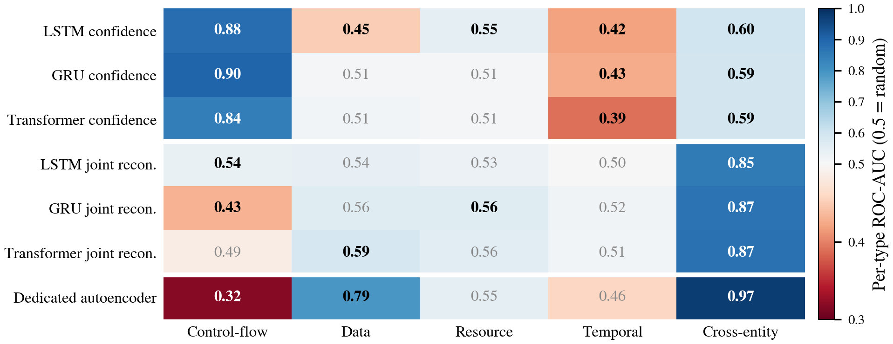

# Real-Time Anomaly Detection for ERP Process Flows

[](https://www.python.org/)
[](https://pytorch.org/)
[](LICENSE)

Deep sequential models that follow an ERP process event by event and flag anomalies while the case is still running. Three next-activity predictors (LSTM, GRU and Transformer) and a GRU sequence autoencoder score every new event. Each of them needs less than 6 ms per event on average, on a laptop CPU.

The models are trained and tested on the public BPI Challenge 2020 travel expense log. Five types of anomalies are injected into held-out cases: control-flow, data, resource, temporal and cross-entity. Trained weights, raw scores and all result files are included, so every number in this README can be checked without retraining.

- [Status](#status)
- [Installation](#installation)
- [Data](#data)
- [Quick start](#quick-start)
- [How it works](#how-it-works)
- [Results](#results)
- [Repository layout](#repository-layout)
- [Where the numbers come from](#where-the-numbers-come-from)
- [Reproducibility](#reproducibility)
- [Known limitations](#known-limitations)
- [License and credits](#license-and-credits)

## Status

| | |
|---|---|
| Python | 3.10 or newer |
| Main libraries | PyTorch 2.2.2, scikit-learn 1.4.2, pm4py 2.7.11.4, pandas 2.2.2 |
| Hardware used | AMD Ryzen 5 PRO 7530U (6 cores), 16 GB RAM |
| GPU | not needed, everything runs on CPU |
| Frozen version | release `v1.0-submission` |

## Installation

```bash
git clone https://github.com/Wasif-Allvi/real-time-erp-anomaly-detection-thesis.git
cd real-time-erp-anomaly-detection-thesis
python -m venv .venv
source .venv/bin/activate          # Windows: .venv\Scripts\activate
pip install -r requirements.txt
```

## Data

The project uses the public [BPI Challenge 2020](https://doi.org/10.4121/uuid:52fb97d4-4588-43c9-9d04-3604d4613b51) event log by Boudewijn van Dongen, published on 4TU.ResearchData. Two of its sub-logs are needed: *Domestic Declarations* and *International Declarations* (16,949 cases and 128,588 events together).

The log is not part of this repository. Download both sub-logs and unpack them into a `dataset/` folder next to the repository folder:

```
dataset/
├── BPI Challenge 2020_ Domestic Declarations_1_all/DomesticDeclarations.xes/DomesticDeclarations.xes
└── BPI Challenge 2020_ International Declarations_1_all/InternationalDeclarations.xes/InternationalDeclarations.xes
real-time-erp-anomaly-detection-thesis/
```

The paths are set in `config.py` if you want to change them.

## Quick start

The trained weights and the per-run anomaly scores are included. To recompute every detection result and figure without training:

```bash
python 01_data_loading.py             # load and merge the two logs
python 02_preprocessing.py            # build the 14 event features
python 03_sequences.py                # prefixes and case-level split
python 06_anomaly_injection.py        # inject anomalies into the test cases
python 13_event_level_evaluation.py   # all detection results
python generate_plots_v2.py           # all result figures
```

The results land in `results/metrics/event_level_results.json` and `results/figures_v2/`.

To run everything from scratch, including training:

```bash
python 01_data_loading.py
python 02_preprocessing.py
python 03_sequences.py
python 05_train.py                    # LSTM, GRU, Transformer, 3 seeded runs each
python 05b_autoencoder.py             # GRU autoencoder, 3 seeded runs
python 06_anomaly_injection.py
python 08_evaluate.py                 # accuracy, latency, throughput
python 10_significance.py             # statistical comparison of the classifiers
python 12_export_raw_scores.py        # per-run anomaly scores
python 13_event_level_evaluation.py
python generate_plots_v2.py
```

Training overwrites the included weights in `results/models/`.

## How it works

**1. Turn the log into prefixes.** The two sub-logs are merged. Each event becomes a vector of 14 features. Seven are categorical: activity, resource, role and four organisation, project and budget identifiers. Seven are numerical: four amount fields, the permit budget, the time since the previous event and the time since the case started. Cases are split 70/10/20 into training, validation and test. Every prefix of a case, up to 26 events, becomes one sample.

**2. Learn normal behaviour.** LSTM, GRU and Transformer encoders each get two output heads. One predicts the next activity out of 37. The other reconstructs the seven numerical features. A separate GRU sequence-to-sequence autoencoder learns to reconstruct the training prefixes. All training data is clean.

**3. Score every event.** Each new event is scored in three ways.

| Score | What it measures |
|---|---|
| Confidence | 1 minus the highest next-activity probability. High when the model cannot tell what comes next. |
| Joint reconstruction | How badly the classifier's second head reconstructs the numerical features. |
| Autoencoder | How badly the dedicated autoencoder reconstructs the prefix. |

A composite score blends confidence and joint reconstruction with a weight α between 0 and 1.

**4. Inject anomalies.** 293 test cases receive one anomaly each. Training and validation data stay untouched.

| Type | What changes |
|---|---|
| Control-flow | *Payment Handled* and *Request Payment* swap timestamps, so the payment comes first. |
| Data | The amount on the first event by an `EMPLOYEE` is multiplied by 10. |
| Resource | The first approval event gets the `EMPLOYEE` role. |
| Temporal | The middle event moves 25 hours back in time. |
| Cross-entity | In a case linked to a travel permit, the amount is multiplied by 5. |

**5. Evaluate per event.**

- A prefix counts as anomalous only once it contains a changed event. Earlier prefixes of the same case still count as normal. This gives 1,349 anomalous prefixes out of 22,238 (6.07 %). Three injected cases had an amount of zero, so the change had no effect and they stay normal.
- Thresholds are picked on one half of the test cases and applied to the other half. This is repeated 1,000 times and averaged.
- Per-type ROC-AUC compares each anomaly type with normal prefixes of the same length, with 95 % bootstrap intervals over cases.
- Isolation Forest and a One-Class SVM serve as classical baselines.

## Results

### Next-activity prediction

Mean of three seeded runs on 22,238 test prefixes. ± is the population standard deviation over the runs.

| Model | Accuracy | F1-macro | Parameters | Mean latency | Throughput |
|---|---|---|---|---|---|
| LSTM | 85.70 % ± 0.25 | 0.4145 | 219,308 | 1.136 ms | 8,380 events/s |
| **GRU** | **86.50 % ± 0.14** | **0.4283** | 167,852 | 3.770 ms | 2,190 events/s |
| Transformer | 84.63 % ± 1.18 | 0.3978 | 74,924 | 1.115 ms | 7,113 events/s |
| GRU autoencoder | | | 90,823 | 5.912 ms | 2,253 events/s |

The GRU is the most accurate model in every seed. McNemar's test confirms each of these wins on the test set (p ≤ 4.3 × 10⁻⁴). All models stay below 10 ms per event, even at the 95th percentile. The slowest is the autoencoder with 8.2 ms.

### Anomaly detection

6.07 % of the test prefixes are anomalous, so a random scorer reaches an AUPRC of 0.0607. Precision and recall are measured at a held-out threshold and averaged over 1,000 splits.

| Scorer | ROC-AUC | AUPRC | Precision | Recall |
|---|---|---|---|---|
| **GRU autoencoder** | **0.7022** | **0.3981** | **0.791** | 0.274 |
| Joint reconstruction (3 models) | 0.588 – 0.617 | 0.097 – 0.105 | 0.085 – 0.091 | 0.34 – 0.38 |
| Confidence (3 models) | 0.482 – 0.491 | 0.056 – 0.057 | 0.061 – 0.064 | 0.62 – 0.96 |
| Isolation Forest | 0.5698 | 0.0695 | 0.071 | 0.667 |
| One-Class SVM | 0.4800 | 0.0633 | 0.061 | 0.590 |

The autoencoder's AUPRC is 6.6 times the random level, and it flags only 0.5 % of normal prefixes. Each of its three runs on its own reaches ROC-AUC 0.694 – 0.699 and AUPRC 0.381 – 0.393.

### Which scorer catches which anomaly



Each cell compares one anomaly type with normal prefixes of the same length. 0.5 means random. Below 0.5, the anomalous prefixes look more typical than normal ones. Bold values have a 95 % interval that excludes 0.5.

- **Confidence** catches control-flow anomalies (ROC-AUC 0.84 – 0.90).
- **Reconstruction** catches the financial ones. The autoencoder reaches 0.79 on data and 0.97 on cross-entity anomalies.
- **Resource and temporal** anomalies slip past every scorer (0.56 at best).
- **Mixing does not help.** The best composite weight is α = 0, which is plain reconstruction, for all three models. The held-out check chose α = 0 in all 200 selections. The two scores work best side by side.

## Repository layout

```
.
├── config.py                       paths, seeds and hyperparameters
├── 01_data_loading.py              load and merge the two XES logs
├── 02_preprocessing.py             features, imputation, encoding, scaling
├── 03_sequences.py                 prefixes, padding, case-level split
├── 04_models.py                    LSTM, GRU and Transformer (imported by the others)
├── 05_train.py                     train the three classifiers
├── 05b_autoencoder.py              train the GRU autoencoder
├── 06_anomaly_injection.py         inject the five anomaly types into test cases
├── 08_evaluate.py                  accuracy, latency, throughput
├── 10_significance.py              statistical comparison of the classifiers
├── 12_export_raw_scores.py         per-run anomaly scores
├── 13_event_level_evaluation.py    all detection results
├── generate_plots_v2.py            all result figures
├── 07_scoring.py                   ┐
├── 09_baseline.py                  │ first, case-level evaluation,
├── 11_per_type_auc.py              │ kept for reference
├── generate_plots.py               ┘
├── check_results.py                ┐
├── debug_recon.py                  ├ small helpers used during development
├── extract_training_summary.py     ┘
├── thesis-code-prototype.ipynb     first prototype (single LSTM, 81.22 % accuracy)
├── requirements.txt
├── LICENSE
└── results/
    ├── models/                     trained weights, 3 runs × 4 models
    ├── metrics/                    JSON and NPZ files behind every number
    ├── figures_v2/                 final figures (PDF and PNG)
    ├── figures/                    first-version figures, raw_scores.npz, score_cache.npz
    └── *.joblib                    fitted encoders, scaler and feature list
```

## Where the numbers come from

| File | Contents |
|---|---|
| `results/metrics/event_level_results.json` | all detection results: scorers, per-type ROC-AUC with intervals, composite grid, autoencoder runs |
| `results/metrics/event_labels.npz` | event-level labels and prefix lengths of the 22,238 test prefixes |
| `results/figures/raw_scores.npz` | per-run scores on the test and validation prefixes, the input of step 13 and of the figures |
| `results/metrics/final_evaluation.json` | accuracy, latency and throughput. Its anomaly block is the earlier case-level evaluation. |
| `results/metrics/significance_results.json` | per-run accuracy and the statistical tests |
| `results/metrics/injection_summary.json` | how many cases were selected and changed per anomaly type |
| `results/metrics/*_train_history.json` | training curves |
| `scoring_results.json`, `autoencoder_results.json`, `baseline_results.json`, `per_type_auc.json` | earlier case-level evaluation, kept for reference |

## Reproducibility

- Seeds: case split 42, anomaly injection 2024, classifier runs 42, 43 and 44, autoencoder runs 142, 143 and 144. The held-out splits and bootstrap resamples in `13_event_level_evaluation.py` are seeded as well.
- Scalers are fitted on training data only. The split is made per case, and no case appears in two partitions.
- The composite score is normalised with clean validation data, so no test information leaks into it.
- `results/preprocessed/` is not tracked. Steps 01 to 03 and 06 rebuild it.
- Isolation Forest results can differ in the fourth decimal across scikit-learn versions.
- Release `v1.0-submission` freezes the exact code, weights and result files behind the numbers in this README.

## Known limitations

- One dataset from one organisation.
- The anomalies are injected. They are not audited real-world fraud cases.
- Thresholds and the composite weight are tuned on held-out halves of the injected test set, not on separate production data.
- Categorical attributes enter the networks as integer codes, and the Transformer does not mask padded positions.
- Each architecture was trained three times.

## License and credits

The code is released under the MIT License, see [LICENSE](LICENSE). The BPI Challenge 2020 log is not included. It is published by 4TU.ResearchData under its own license, so check the dataset page before you reuse it.

Developed by Mustafa Wasif Allvi at the University of Potsdam as part of a Master's thesis.
